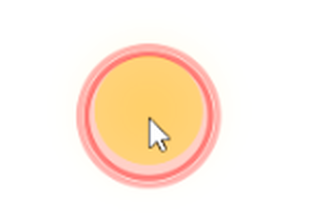
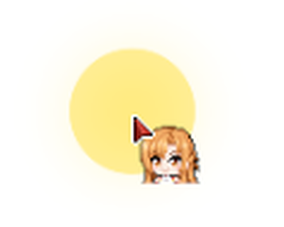
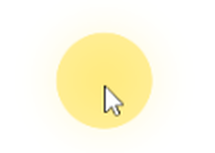
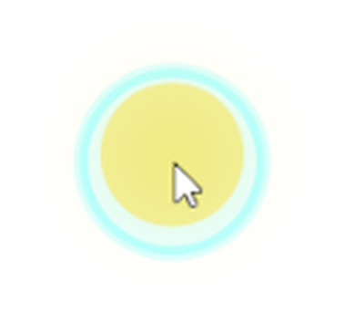
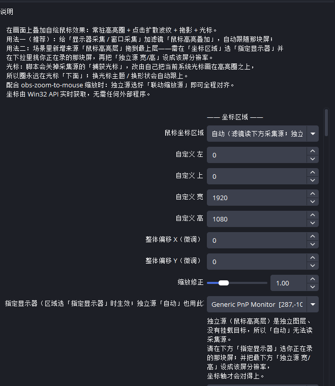
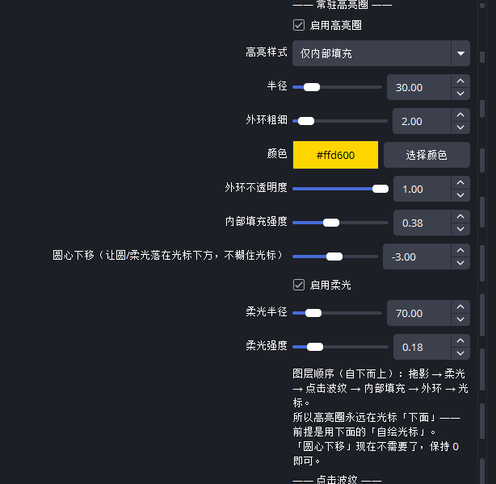
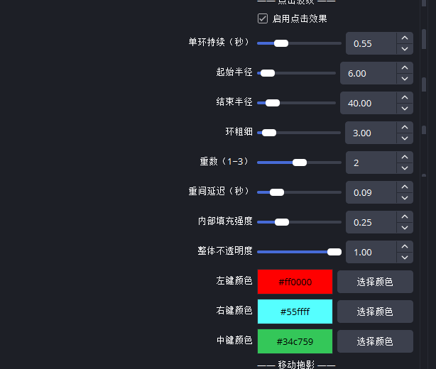
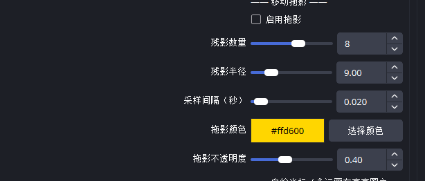
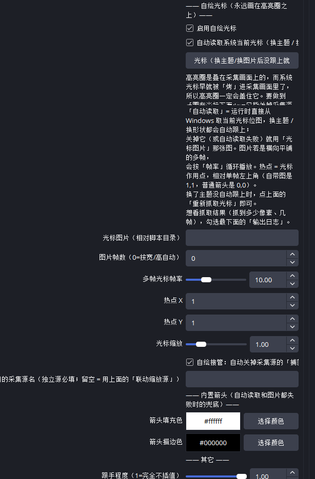

简体中文 | [English](README.en.md)

# OBS 鼠标高亮叠加 (Mouse FX)

<p align="center">
  
</p>

一个 **OBS 内置 Lua 脚本**：直接在画面里画出鼠标高亮圈、点击波纹、移动拖影，
并把系统光标画在**最上层**——教程 / 演示录屏神器。

## 特性

- **常驻高亮圈**：外环 + 内部半透明填充，可分别开关（默认黄环 + 柔和填充），
  半径、粗细、颜色、柔光都能调
- **点击波纹**：点击时扩散的圆环，左 / 右 / 中键可分别设颜色，支持 1~3 重环叠加
- **移动拖影**（可选）：跟随鼠标的残影
- **自绘系统光标**（核心特性）：脚本实时向 Windows 抓取当前光标位图（含热点），
  画在**最上层**，所以高亮圈永远在光标「下面」，不会把光标染色 / 盖住：
  - 换光标主题 / 换形状（箭头 ↔ 文本 ↔ 手型）**自动跟上**
  - 动画光标（`.ani`）连采 5 帧循环播放
  - 抓取失败会自动回落：自带箭头图 → 内置 SDF 箭头，永远不会没光标
- **兼容任意自定义光标主题** —— Windows 上用哪套光标主题，画出来的就是哪套：

  <p align="center"></p>

- **多显示器**：自动匹配采集源对应的那块物理屏，多屏坐标不会乱
- **联动缩放**：配合 [obs-zoom-to-mouse](https://github.com/BlankSourceCode/obs-zoom-to-mouse) 放大跟焦时，
  每帧重映射坐标，放大过程中叠加层始终锁定
- **零依赖**：不需要 Python 服务、浏览器源或任何后台程序，一个 Lua 脚本 + 一个 effect 文件搞定

更多效果：

<p align="center">
  
  
</p>

## 安装

### 一、拿到文件

从 [Releases 页面](https://github.com/XxkumaXia/obs-mouse-fx/releases) 下载
`obs-mouse-fx-v1.1.0.zip` 并解压（也可以直接克隆本仓库，用里面的 `obs-fx` 目录）。

> `mouse-fx.lua`、`mouse-fx.effect`、`blank.png` 三个文件**必须放在同一目录**，
> 拆开 OBS 就加载不了。目录路径建议不含中文（例如 `D:\obs-fx`），
> 个别 OBS 版本加载非 ASCII 路径会失败。

### 二、在 OBS 里加载脚本

1. 打开 OBS → 菜单 **工具 → 脚本**
2. 在「脚本」窗口左下角点 **+**
3. 浏览到解压出来的目录，选中 **`mouse-fx.lua`** → 打开
4. 加载成功后，左侧脚本列表里出现 `mouse-fx.lua`，右侧就是它的参数面板，
   参数**改完立即生效**，不用重启 OBS
5. OBS 会记住添加过的脚本，下次启动**自动加载**，不用重复添加

<p align="center"></p>

### 三、加到场景里

按下面两种用法任选其一，见 [用法](#用法)。

### 更新脚本

用新文件覆盖旧文件后，点「脚本」窗口底部的**刷新脚本**（圆形箭头）按钮即可。
OBS 加载的是你当初选择的那个路径下的文件，所以如果换了目录，需要在脚本列表里移除后重新添加。

## 用法

### 用法 A：给采集源加滤镜（推荐）

「显示器采集 / 窗口采集 / 游戏采集」右键 → **滤镜** → 左下 **+**（效果滤镜）→
选 **鼠标高亮叠加 (Mouse FX)**。
滤镜会自动识别你采集的是哪块屏并换算坐标，多屏也不用管。

### 用法 B：独立叠加层

场景 → 来源 **+** → **鼠标高亮层 (Mouse FX)**，拖到最上层。
填好「联动缩放源」（或「接管用的采集源名」）后，脚本会按名字找到那台采集源、
读出它正在捕获哪块屏——**区域和宽高自动跟随，换屏录制不用改设置**；
也可以「坐标区域 → 指定显示器」手动固定，并把「独立源 宽/高」设成那块屏的分辨率：

<p align="center"></p>

### 和 [obs-zoom-to-mouse](https://github.com/BlankSourceCode/obs-zoom-to-mouse) 一起用（缩放跟焦）

两个脚本叠加没问题，但几条硬规则（完整排障见 `obs-fx/使用说明.md`）：

- **两种用法二选一**：采集源挂滤镜，场景里就别放「鼠标高亮层」；放了独立层，它身上
  **别再挂任何滤镜**——独立源是最终输出层，挂滤镜就是画两遍（「一大一小、颜色发灰」的元凶）
- **滤镜版**：挂在采集源上、排在 zoom 裁剪滤镜**下方**，会跟着一起被裁剪放大，天然对齐
- **独立层版**：拖到最上层，「联动缩放源」选被放大的采集源，每帧按裁剪框重映射，圈和柔光同步放大
- **「捕获光标」保持关闭**：由「自绘接管」自动关，谁手动勾回来谁就是两个光标
- **多屏**：「坐标区域」选**自动**（别选「主屏」——Windows 主屏名分不一定是你录的那块），换屏 2 秒自动跟上

### 高亮圈在光标「下面」是怎么做到的？

OBS 的「显示器采集」会把系统光标**直接画进采集画面**，而高亮圈叠在画面之上，
物理上不可能钻进画面，半透明填充必然糊在光标上。

本插件的解法：勾选「自绘接管」后，脚本自动关掉采集源的「捕获光标」，
改为把当前光标**自己画在最上层**。图层顺序固定为：

```
拖影 → 柔光 → 点击波纹 → 内部填充 → 外环 → 光标（永远在最上）
```

## 参数

脚本面板按「坐标区域 / 常驻高亮圈 / 点击波纹 / 移动拖影 / 自绘光标 / 其它」分组。要点：

| 分组 | 关键项 |
|---|---|
| 常驻高亮圈 | 高亮样式、半径、外环粗细、颜色、不透明度、柔光 |
| 点击波纹 | 单环持续、起始/结束半径、环粗细、重数 1~3、三键颜色 |
| 移动拖影 | 残影数量、半径、采样间隔、颜色 |
| 自绘光标 | 自动读取系统光标、重新抓取按钮、图片兜底、热点、缩放 |
| 坐标区域 | 自动 / 主屏 / 虚拟桌面 / 自定义 / 指定显示器 |
| 其它 | 跟手程度、联动缩放源、输出日志 |

<p align="center">
  
  
</p>

<p align="center">
  
  
</p>

完整参数表见 **[obs-fx/使用说明.md](obs-fx/使用说明.md)**。

## 排障

打开「输出日志」开关后重载脚本，在 OBS 日志（帮助 → 日志文件）里找 `[鼠标高亮]` 开头的行，
正常应看到 `首帧渲染完成`。常见问题速查：

| 现象 | 处理 |
|---|---|
| 圈的位置偏移 | 看日志「映射区域」行；不对就改「坐标区域 → 自定义」手填该屏左上角与分辨率 |
| 独立层位置对不上 | 「联动缩放源」填成当前在录那块屏的采集源，「坐标区域」选**自动**（区域和宽高自动跟随）；或「坐标区域 → 指定显示器」选对屏，「独立源 宽/高」设成该屏分辨率 |
| 画面上两个光标 | 采集源的「捕获光标」没被关掉。确认「自绘光标」和「自绘接管」都勾着；接管失败原因现在会直接打在 OBS 日志里 |
| 换光标主题没跟上 | 点「重新抓取光标」按钮 |
| 完全不出效果 | 确认三个文件在同一目录、滤镜已启用、日志有「首帧渲染完成」 |

完整排障表见 [obs-fx/使用说明.md](obs-fx/使用说明.md#五排障)。

## 二次开发

见 **[DEVELOPMENT.md](DEVELOPMENT.md)**：原理拆解、关键代码索引、历史踩坑记录，
以及 `dev-archive/` 里的光标解析 / 掩码修复验证 / FFI 审计 / 光标图重生成等调试脚本。

## 平台

仅 **Windows**（坐标与光标都走 Win32 API / LuaJIT `ffi`）。
OBS Studio 28+（LuaJIT + libobs 图形接口）实测可用。

## 协议

[MIT](LICENSE)。自带 `cursor.png` 由 `dev-archive/make_cursor_png.py` 生成的中性箭头图，无第三方版权。
