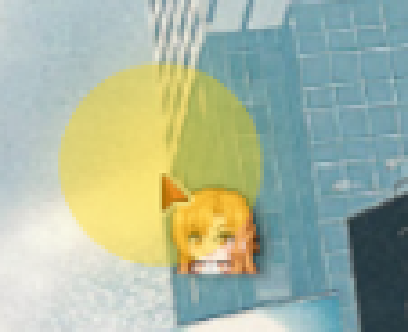

# OBS 鼠标高亮叠加 (Mouse FX)

一个 **OBS 内置 Lua 脚本**：装上之后，直接在画面里画出鼠标高亮圈、点击波纹、移动拖影，
并把系统光标画在最上层——**教程 / 演示录屏神器**。



## 特性

- **常驻高亮圈**：外环 + 内部半透明填充，颜色 / 半径 / 粗细可调（默认黄圈）
- **点击波纹**：左 / 右 / 中键可设不同颜色，支持 1~3 重扩散环
- **移动拖影**（可选）：跟随鼠标的残影
- **自绘光标**（核心）：脚本实时向 Windows 抓取当前光标位图（含热点）画在**最上层**，
  所以高亮圈永远在光标「下面」，不会把光标染色 / 盖住
  - 换光标主题 / 换形状（箭头↔文本↔手型）**自动跟上**；动画光标连采 5 帧循环播放
  - 抓取失败自动回落：自带箭头图 → 内置 SDF 箭头，永远不会没光标
- **多显示器**：自动匹配采集源对应的物理屏，多屏坐标不乱
- **联动缩放**：配合 [obs-zoom-to-mouse](https://github.com/tryptophane/obs-zoom-to-mouse) 放大跟焦时自动重映射坐标
- **零依赖**：不需要 Python 服务、浏览器源或任何后台程序，一个 Lua 脚本 + 一个 effect 文件搞定

## 安装

1. 下载本仓库的 `obs-fx` 目录（三个文件 `mouse-fx.lua` / `mouse-fx.effect` / `blank.png`
   必须放在一起，别拆开）
2. OBS 菜单 → **工具 → 脚本** → 点 **+** → 选 `obs-fx/mouse-fx.lua`
3. 参数改完立即生效，无需重启

> 路径建议不含中文（个别 OBS 版本加载非 ASCII 路径会失败）。

## 用法

### 用法 A：给采集源加滤镜（推荐）

「显示器采集 / 窗口采集 / 游戏采集」右键 → **滤镜** → **+** → 选 **鼠标高亮叠加 (Mouse FX)**。
滤镜会自动识别你采集的是哪块屏，多屏也不用管。

### 用法 B：独立叠加层

场景 → 来源 **+** → **鼠标高亮层 (Mouse FX)**，拖到最上层。
独立层不知道你录的是哪块屏，需要在脚本面板「坐标区域 → 指定显示器」里选一下，
并把「独立源 宽/高」设成那块屏的分辨率。

### 高亮圈在光标「下面」是怎么做到的？

OBS 的「显示器采集」会把系统光标**直接画进采集画面**，而高亮圈叠在画面之上，
物理上不可能钻进画面，半透明填充必然糊在光标上。

本插件的解法：勾选「自绘接管」后，脚本自动关掉采集源的「捕获光标」，
改为把当前光标**自己画在最上层**。图层顺序固定为：

```
拖影 → 柔光 → 点击波纹 → 内部填充 → 外环 → 光标（永远在最上）
```

## 参数

脚本面板按「坐标区域 / 常驻高亮圈 / 点击波纹 / 移动拖影 / 自绘光标 / 其它」分组，
完整参数表见 **[obs-fx/使用说明.md](obs-fx/使用说明.md)**。

## 排障

打开「输出日志」开关后重载脚本，在 OBS 日志（帮助 → 日志文件）里找 `[鼠标高亮]` 开头的行，
正常应看到 `首帧渲染完成`。常见问题速查：

| 现象 | 处理 |
|---|---|
| 圈的位置偏移 | 看日志「映射区域」行；不对就改「坐标区域 → 自定义」手填 |
| 独立层位置对不上 | 「坐标区域 → 指定显示器」选对屏，「独立源 宽/高」设成该屏分辨率 |
| 画面上两个光标 | 确认「自绘光标」和「自绘接管」都勾着 |
| 换光标主题没跟上 | 点「重新抓取光标」按钮 |
| 完全不出效果 | 确认三个文件在同一目录、滤镜已启用、日志有「首帧渲染完成」 |

完整排障表见 [obs-fx/使用说明.md](obs-fx/使用说明.md#五排障)。

## 改代码 / 二次开发

见 **[DEVELOPMENT.md](DEVELOPMENT.md)**：原理拆解、关键代码索引、历史踩坑记录，
以及 `dev-archive/` 里的光标解析 / 掩码修复验证 / FFI 审计等调试脚本。

## 平台

仅 **Windows**（坐标与光标都走 Win32 API）。OBS Studio 28+（LuaJIT + libobs 图形接口）实测可用。

## License

[MIT](LICENSE)。`cursor.png` 为本仓库脚本生成的中性箭头图，无第三方版权。
